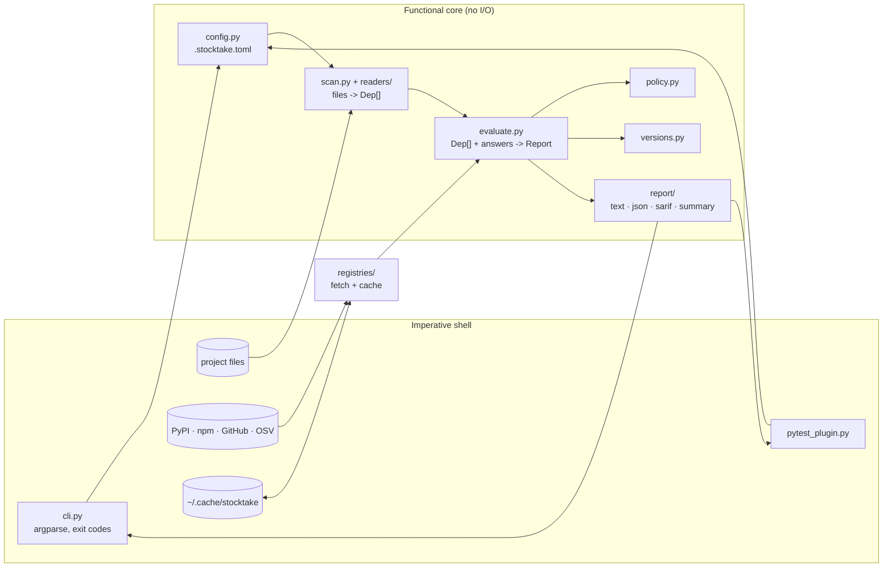
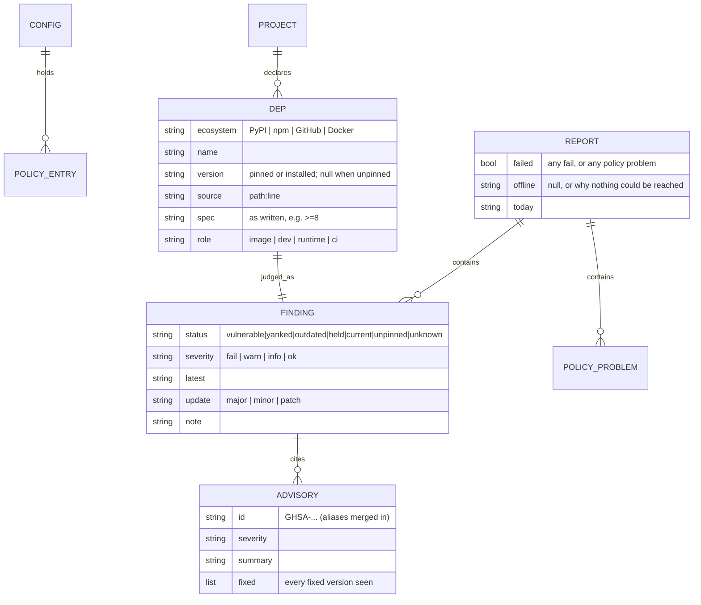
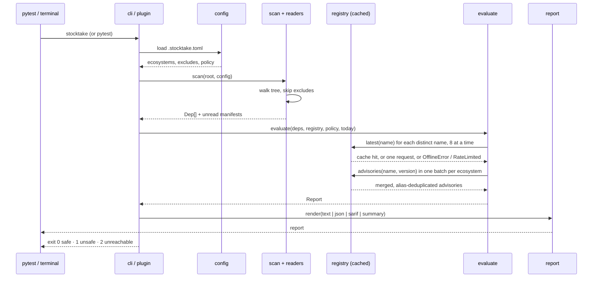

# StockTake: architecture

## Stack and rationale
| Choice | Why | Alternative considered |
|---|---|---|
| Python 3.11+ | `tomllib` is in the standard library from 3.11, so config and policy parse with no dependency. The author's projects already run Python. | 3.9/3.10 with a vendored TOML parser: a dependency or a copy of someone else's parser, for two older versions nothing needs. |
| Standard library only, at runtime | A dependency checker that drags in a dependency tree is absurd, and it has to install into projects that are fussy about what they add. `urllib`, `json`, `tomllib`, `argparse`, `concurrent.futures` cover all of it. | `httpx` + `tomli` + `pydantic`: nicer to write, heavier to adopt, and a supply-chain surface in the one tool meant to watch the supply chain. |
| `packaging` as a soft optional | Correct PEP 440 comparison when it happens to be importable, with a built-in fallback that handles the real cases. Never declared as a dependency. | Declaring it: one dependency, for a marginal gain over the fallback. |
| hatchling + uv | Standard PEP 621 build backend with no configuration, and `uv tool install` is how the tool is meant to be used. | Poetry: its own manifest dialect; setuptools: more configuration for the same result. |
| pytest, ruff, mypy | What the author's other projects use. The delivered pytest plugin must be a pytest plugin anyway. | unittest: no plugin story, and no fixtures for the faked network. |
| argparse with sub-commands | `stocktake`, `stocktake vendor`, later `stocktake propose`. Standard library, and the help text is the documentation most people will read. | click/typer: a dependency, for argument parsing. |

## Shape of the thing
A functional core with an imperative shell. Everything that decides anything is a pure function over plain data; everything that touches the network, the filesystem or the clock is passed in. That is why the existing 33 tests run with no network and why they are fast.



The one rule that keeps this honest: **`evaluate()` takes a registry object and never constructs one.** Tests pass a fake; the CLI passes the real one.

## Folder structure and module boundaries
```
src/stocktake/
  __init__.py            public API: scan, evaluate, Report, Finding, Dep, __version__
  __main__.py            python -m stocktake
  cli.py                 argparse, sub-commands, exit codes. The only module that calls sys.exit.
  models.py              Dep, Finding, Report, Advisory. Frozen dataclasses, no behaviour beyond derived properties.
  versions.py            comparison and update size, per ecosystem. Pure.
  config.py              .stocktake.toml: ecosystems, excludes, policy, cache settings. Pure given text.
  policy.py              applying and validating policy. Pure.
  scan.py                walking the tree, honouring excludes, dispatching to readers, finding unread manifests.
  evaluate.py            the judgement: Dep[] + registry answers -> Report. Pure given a registry.
  readers/
    base.py              the Reader protocol and the registry of readers
    dockerfile.py        pip/uv/pipx pins, FROM tags, GitHub release downloads
    python_project.py    pyproject.toml, requirements*.txt
    python_locks.py      uv.lock, poetry.lock, Pipfile.lock
    npm.py               package.json, package-lock.json, pnpm-lock.yaml, yarn.lock
    workflows.py         .github/workflows/*.yml  uses: owner/repo@ref
  registries/
    base.py              the Registry protocol: latest(), advisories()
    http.py              fetch with timeouts, the six-hour cache, OfflineError / RateLimited
    pypi.py  npm.py  github.py  osv.py
  report/
    text.py  json.py  sarif.py  summary.py
  pytest_plugin.py       the drop-in check, entry point "stocktake"
  vendor.py              building the single-file copy
  templates/
    test_dependencies.py the copy-in test file `stocktake init` writes
tests/                   mirrors the above; one guard-test module per reader
docs/
```

Boundaries that matter:
- **`readers/` never touches the network. `registries/` never touches the project.** A reader turns bytes into `Dep`s; a registry client turns a name into versions and advisories. Neither knows the other exists.
- **Nothing outside `registries/` calls `urllib`.** Nothing outside `scan.py` and `readers/` reads a project file.
- **`report/` is a pure function of a `Report`.** No module in `report/` re-reads a file or asks a registry anything.
- **`cli.py` is the only module that knows about exit codes or prints.**

### Adding an ecosystem
A reader is a function with a declared interest and no state:

```python
# readers/base.py
class Reader(Protocol):
    name: str                      # "python", "npm", "workflows", "containers"
    def interested(self, path: Path) -> bool: ...
    def read(self, path: Path, text: str, ctx: Context) -> Iterable[Dep]: ...
```

`Context` carries the project root and an `installed(name)` callable, so a reader can report the version actually present in the environment without importing `importlib.metadata` itself (and so tests can fake it). Adding Go means one file in `readers/`, one in `registries/`, one line in each registry of implementations, and a guard test. Nothing else changes.

## Data model


`Dep` is frozen; `Finding` and `Report` are built once and not mutated.

## How one run goes


Concurrency is a fixed pool of eight lookups. Advisories go in one batched request per ecosystem, not one per package.

## External services
| Service | Asked | Sent | If it fails |
|---|---|---|---|
| pypi.org/pypi/{name}/json | newest release, which releases are yanked | the package name | that name becomes `unknown` |
| registry.npmjs.org/{name} | newest version | the package name | that name becomes `unknown` |
| api.github.com/repos/{repo}/releases/latest | newest release tag | owner/repo | `unknown`; 403/429 is rate limiting, not an outage |
| api.osv.dev/v1/querybatch + /vulns/{id} | advisories against a version | name, version, ecosystem | advisories unknown for the run; never treated as clean |

Every answer is cached for six hours in `~/.cache/stocktake/cache.json`, shared across projects. `--refresh` ignores it. One `User-Agent: stocktake/<version>`. `GITHUB_TOKEN`, if set in the environment, raises GitHub's anonymous limit and is sent to api.github.com only.

**If all lookups fail, the run is `offline`:** exit 2, the pytest test skips, and nothing is reported as clean. **If some fail**, those names are `unknown` and the rest of the run still counts. That distinction is the whole of NFR-5 and NFR-7.

## Cross-cutting concerns
- **Errors.** Two exceptions cross the network boundary: `OfflineError` (could not reach it) and `RateLimited` (it asked us to slow down; that one answer is unknown). Nothing else is caught broadly. A malformed registry answer is a bug and should raise.
- **Configuration.** One file, `.stocktake.toml` at the project root, holding ecosystems, excludes and policy. Nothing is configured by environment variable except `GITHUB_TOKEN`, `STOCKTAKE_CACHE` and `STOCKTAKE_OFFLINE` (for testing offline behaviour deliberately).
- **Logging.** None. The report is the output; the exit code is the signal. A CLI tool that logs to stderr on a normal run is noise in a test suite.
- **Caching.** Keyed by URL plus a hash of any request body, written atomically through a temp file and a rename, and a damaged cache file is ignored rather than fatal.
- **Security model.** The tool reads the project and writes nothing in it. It sends names and versions. It never executes anything it found — no importing a scanned package, no running a lockfile's scripts, no shelling out to a package manager. A malicious manifest can at worst cause a nonsense name to be looked up.
- **Time.** `today` and `now` are parameters with defaults, never read directly in the core, so policy expiry and cache ageing are testable.

## What is deliberately not here
No database, no server, no state beyond the cache, no concurrency beyond the lookup pool, no plugin discovery via entry points in v1 (the reader registry is a list in one file; entry points can come when someone else wants to add a reader out of tree).
